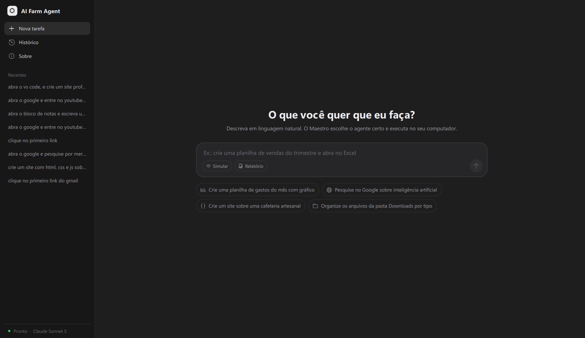
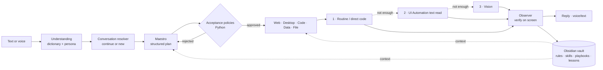
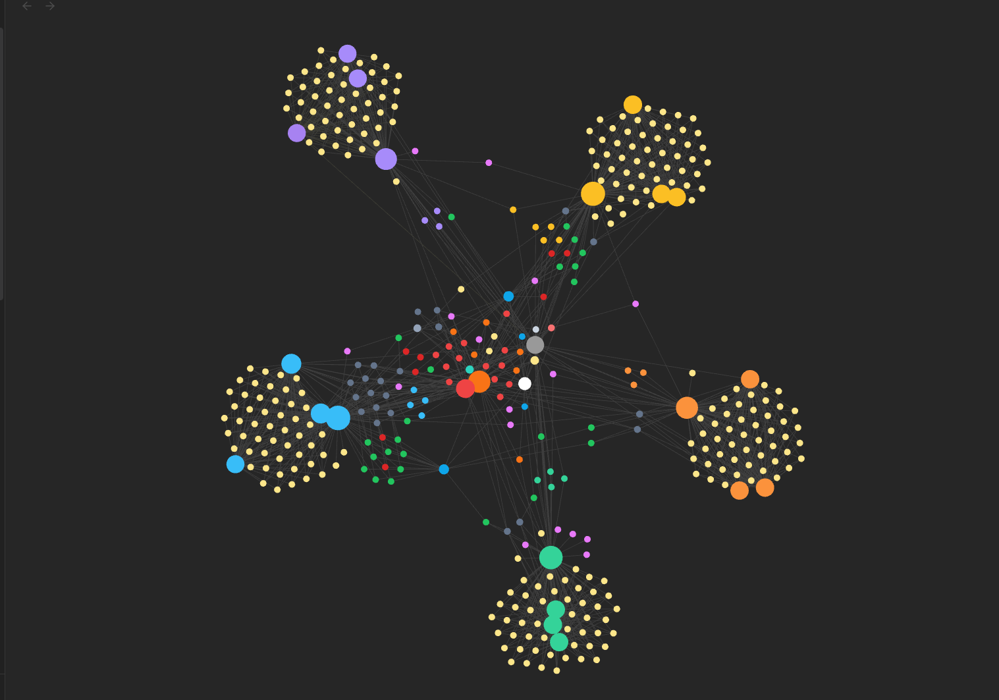
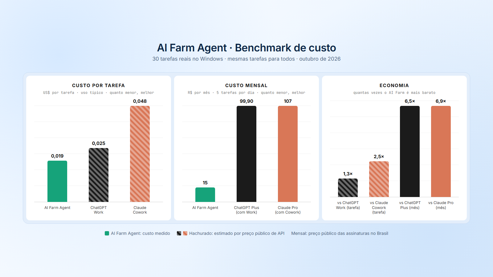

# AI Farm Agent

**A Windows multi-agent assistant for natural-language desktop tasks and verifiable code and spreadsheet artifacts.**

[](LICENSE)


[](https://github.com/ognistie/AI-Farm-Agent/actions/workflows/ci.yml)

[Highlights](#highlights) · [Architecture](#architecture) · [Second brain](#second-brain) · [Voice](#voice-and-conversation) · [Benchmark](#cost-benchmark) · [Getting started](#getting-started) · [Evaluation](#evaluation) · [Security](#security-and-privacy) · [Contributing](CONTRIBUTING.md)



## Overview

AI Farm Agent turns a request such as *"abre o Excel e preenche a primeira linha com Produto, Preço e Quantidade"* into a plan, validates it, executes it on the Windows desktop and checks the result on screen. A central orchestrator, **Maestro**, delegates to domain agents (Web, Desktop, Code, Data, File). Every agent reads an editable **Obsidian knowledge vault** before acting and writes the outcome back.

The design principle is **intelligence only where it is needed**:

1. Use a deterministic routine when one exists, with no model call.
2. Otherwise, read the screen as text through Windows UI Automation.
3. Fall back to vision only as a last resort.

Policies written in Python, not in prompts, decide whether a plan may run.

> **Status:** experimental and under active development. The interface and voice understanding are in Brazilian Portuguese. Run it in a dedicated environment; see [Security and privacy](#security-and-privacy).

## Highlights

| | |
| --- | --- |
| **Continuous conversation** | Follow-ups act on what is already open. *"Abre o YouTube"* → *"agora toca o segundo vídeo"* continues in the same tab; *"muda a cor do título"* edits the project just created, with a backup to undo. Conversations are saved and can be reopened. |
| **Stays out of the way** | When the agent moves to another app, the main window steps aside and the conversation continues in a mini chat in the bottom-right corner. While a task runs, the mini chat takes no focus or clicks, so it never interferes with what the agent types; `Ctrl+Alt+X` stops the task from anywhere. |
| **Real-time conversation** | Add `OPENAI_API_KEY` to talk with GPT-Live 1 in Conversa mode: it listens and speaks at once, tasks run through the Maestro, and the paid session closes when idle. The microphone goes to OpenAI during that conversation. Without the key, or with the option off, capture, faster-whisper and Piper stay local. |
| **Multi-agent orchestration** | Maestro plans and routes to domain agents; deterministic validators and execution-time policies check the proposed operations. |
| **Deterministic guardrails** | Acceptance policies validate plans before dispatch, and execution-time policies restrict tools by agent. Generated-code execution is disabled. Consequential GUI effects still require broader validation before a production release. |
| **Second brain** | The Obsidian vault provides the agent's rules, known failures, playbooks, lessons learned, a ~2,600-variant Brazilian speech dictionary and the AIWorkbench engineering skills. Each request retrieves only what matches it. |
| **Measured cost** | Each model call is metered. In a 30-task benchmark the average cost was **US$ 0.019 per task**. |

## Architecture



### Request lifecycle

1. **Understand:** the dictionary fixes known transcription errors and slang. Simple requests ("open X", "search Y", time/date) are answered without a model call.
2. **Resolve:** with something open, the resolver decides whether the request continues in that window/tab or starts a new task.
3. **Plan:** Maestro decomposes the request with retrieved references and lessons, then `plan_validator.py` applies the acceptance policies.
4. **Execute:** agents emit steps. The automation engine runs routines directly. Open-ended goals go to the **browser pilot** or the **app pilot**, which read the window as numbered UI elements, choose one action per turn and re-read to confirm.
5. **Verify and record:** the observer checks the resulting window, tab or file. The reply is composed, and the plan, outcome and consulted notes are written to the vault.

### Repository layout

```text
AI-Farm-Agent/
├── ai-farm-agent/            Application
│   ├── agents/               Maestro, domain agents, sub-agents, validators
│   ├── core/                 LLM client, automation engine, pilots, brain, skills, session
│   │   └── voice/            Recorder, STT, TTS, understanding, persona, hotkey
│   ├── desktop/              PySide6/QML UI, controller, voice controller
│   ├── memory/               Route memory
│   ├── scripts/              Smoke tests, evaluations, benchmark
│   ├── state_maps/           Application navigation maps
│   └── main.py               Entry point
├── AI-Farm-agents/           Obsidian vault (second brain)
├── docs/                     Images and security review
└── config.yaml               Models, effort per agent, voice settings
```

## Second brain



The vault in `AI-Farm-agents/` is plain Markdown with frontmatter and wiki links. Obsidian is optional: the runtime reads the files directly through `core/brain.py`, and the application keeps working if the vault is missing.

For each request, `Brain.context_for(agent, task)` assembles a bounded block. It is budgeted per whole block, so nothing is cut mid-sentence. It contains:

- **Agent notes:** execution rules, how-to and known failures of the agent.
- **Skills:** the 1–3 most relevant [AIWorkbench](https://github.com/BielmFranco/AIWorkbench) skills for that agent and request, with only the lines written for that agent (`core/skills.py`).
- **Playbooks and reference tasks:** curated entries rank above automatically recorded executions.
- **Lessons learned:** every real failure that became a rule.
- **Dictionary terms:** Windows settings pages, keyboard shortcuts and app launch targets cited in the request.

The plan note records **"Consultou: …"** with every note and skill used. All of this is reference material: it never widens permissions, which live in Python.

| Vault directory | Purpose |
| --- | --- |
| `00 Maestro/` | Orchestration, conversation, voice, persona, evaluations, benchmark |
| `10 Agentes/` | Agent notes, playbooks and sub-agent descriptions |
| `20 Politicas/` | Human-readable acceptance policies |
| `30 Skills/` | AIWorkbench skills as usage manuals (when to activate, how each agent applies them, what to check) |
| `30 Tarefas de referencia/` | Curated procedures with paths, evidence and acceptance criteria |
| `60 Aprendizados/` | Curated lessons learned |
| `70 Dicionario/` | Brazilian speech dictionary, Windows settings pages, keyboard shortcuts |
| `40 Execucoes/`, `50 Diario/` | Local execution records (generated notes are git-ignored) |

## Voice and conversation

With `voice.tts: auto`, adding `OPENAI_API_KEY` to the local `.env` and restarting selects
**GPT-Live 1**. In Conversa mode it hears the microphone and answers in real time. Each utterance
is also checked by the app, which decides what becomes a task, runs it through the Maestro and
hands the verified result back to be spoken. The session closes when idle and reopens when local
detection hears speech, so silence costs nothing. If GPT-Live fails, the conversation continues with
local transcription and Piper. Settings has a switch to keep Conversa fully local.

GPT-Live charges for **all session seconds**, including startup/wait/finalization; this is not
billing only for words heard. Backend model usage is separate. Current rate: US$ 0.05/minute,
billed per second ([official pricing](https://developers.openai.com/api/docs/models/gpt-live-1)).
The default application quota is 1,800 seconds per UTC day (about US$ 1.50). See the
[voice architecture and activation guide](docs/architecture/voice-on-demand.md) for limits,
fallback, accounting recovery and the optional paid smoke test.

- **Pipeline:**
  1. Microphone → local transcription (faster-whisper `small`, int8, CPU).
  2. Dictionary correction. Only `auto` confusions are rewritten; `dica` entries are hints for the model.
  3. One understanding call that returns the clean command, the continuation target and the immediate spoken reply.
- **Instant answers:** time, date and simple open/search requests have no model latency. A cut-off request ("abre o…") gets a clarifying question instead of a guess.
- **Persona:** one speaking style shared by voice, end-of-task replies and small talk. It is editable in `00 Maestro/Persona do assistente.md`, with ready-made lines that never repeat the last ones.
- **Local listening mode:** without GPT-Live, local capture segments utterances while tasks run and barge-in cancels speech.
- **Desktop app:**
  - Alt+Space quick access from any app;
  - custom instructions and settings (Ctrl+,);
  - attachments by "+" or drag and drop;
  - optional plan review before executing;
  - conversation search, rename and delete.
- **Curated memory:** current rules and playbooks guide the agents; task references require independent evidence before becoming verified. Unproven references remain versionable outside verified-reference retrieval (see `00 Maestro/Mapa de roteamento`).
- **Fast follow-ups:** an action inside what is already open goes straight to the agent that owns it, with no planning call. Questions about a file the assistant just created ("resume a planilha") are answered by reading the file.
- **Memory:** each turn keeps its literal content (message, dictated text, query). "Send the same message again" therefore works across turns, and the oldest turns are dropped first when the context is full.

## Cost benchmark



`scripts/bench_cost.py` ran 30 real tasks through the voice path, twice each: apps, browser, code, files, spreadsheets and questions. It recorded every model call (tokens, cache, cost) and every action. The run took place in October 2026.

| | AI Farm Agent (measured) | ChatGPT Work (estimated) | Claude Cowork (estimated) |
| --- | --- | --- | --- |
| Cost per task, typical scenario | **US$ 0.019** | US$ 0.025 | US$ 0.048 |
| Monthly, 5 tasks/day | **≈ R$ 15** | R$ 99.90 (ChatGPT Plus) | R$ 107 (Claude Pro) |

**Where the savings come from.** The same run would cost:
- 1.5× more without prompt caching;
- 1.3× more without deterministic routines;
- 1.9× more on a larger model;
- 3.5× more without all three.

**Method and limits:**
- **Competitors** were estimated as the API-equivalent cost of a screenshot agent using the same number of steps, at public prices. Their system prompt is assumed already cached.
- **In a lean competitor scenario the cost is roughly equal.** The monthly advantage shrinks above ~30 tasks/day.
- **Not compared:** quality and the real limits of the subscriptions.

The full report, with per-task numbers and assumptions, is in `AI-Farm-agents/00 Maestro/Benchmark de custo.md`.

## Getting started

### Requirements

- Windows 10 or 11 with an interactive desktop session.
- Python 3.11 or later.
- An Anthropic API key.
- Optional: microphone and speakers for voice mode. The speech models (~0.5 GB) are downloaded on first use.

### Installation

```powershell
git clone https://github.com/ognistie/AI-Farm-Agent.git
cd AI-Farm-Agent
python -m venv .venv
.\.venv\Scripts\python.exe -m pip install -r ai-farm-agent\requirements.txt
Copy-Item .env.example .env   # then set ANTHROPIC_API_KEY in .env
```

### Run

Start from the repository root so `config.yaml` is found:

```powershell
.\.venv\Scripts\python.exe ai-farm-agent\main.py
```

The app opens on a short intro screen; press any key or click to enter (`ui.splash: false` skips it). The voice hotkey defaults to `Ctrl+Alt+V` and the stop hotkey to `Ctrl+Alt+X`. The `ui` section of `config.yaml` also turns the mini chat on or off (`mini_chat`) and can hide it from screen captures (`mini_hide_from_capture`). Models, per-agent reasoning effort and voice settings are in `config.yaml`; `MODEL_FAST` / `MODEL_STRONG` override the model tiers.

### Example requests

```text
Abre o YouTube e procura lofi pra estudar        →  agora toca o segundo vídeo
Pesquisa o preço do fone JBL Tune 520 no Mercado Livre e me fala o mais barato
Cria um site para a padaria Pão Dourado          →  muda a cor do título para roxo
Abre as configurações do Windows                 →  clica em Sistema
Faz uma planilha de gastos mensais com 5 categorias e o total
Organiza a pasta Downloads por tipo
```

## Evaluation

| Script | What it checks | Model calls |
| --- | --- | --- |
| `scripts/smoke_code_agent.py` | Deterministic regression suite (430+ checks): routing, policies, voice understanding, vault retrieval, skills, security guards | None (mocked) |
| `scripts/eval_voice.py` | 50 hard utterances: misheard names, slang, self-correction, background talk | Yes (~US$ 0.17) |
| `scripts/eval_conversations.py` | 28 multi-turn scenarios through resolver → Maestro → agent plans, without executing | Yes (~US$ 0.15) |
| `scripts/eval_skills.py` | A/B of the Code agent with and without skills | Yes (~US$ 0.70) |
| `scripts/bench_cost.py` | Cost benchmark; **executes real tasks on the desktop** | Yes (~US$ 1.20) |

```powershell
cd ai-farm-agent
..\.venv\Scripts\python.exe -X utf8 scripts\smoke_code_agent.py
```

Model-backed scripts write their reports to the vault (`--vault`). Review them before running: they spend API credits, and `bench_cost.py` opens and operates applications.

## Security and privacy

The application runs with the permissions of the current Windows user. CODE and DATA now create artifacts from bounded manifests, without executing generated creator scripts. Direct Python, shell and package-install actions are rejected by the application executor. Browser automation can use your signed-in sessions. **Use a dedicated environment with non-sensitive files and accounts while end-to-end desktop and voice validation is pending.**

Implemented controls:
- simulation is intercepted before any tool handler runs;
- FILE plans use declarative tools with request scope validation; existing destinations are preserved and deletion uses the recycle bin;
- plan approvals carry a token; cancellation retains the execution slot until the controller finishes;
- automatic diagnostic captures are disabled by default (`privacy.capture_enabled`); vision tools still observe the screen when invoked;
- acceptance policies before execution;
- `open_path` refuses executables, disk images and network/UNC paths;
- the Start-menu fallback refuses names containing commands or paths;
- page and window text in model context is treated as data, never as instructions;
- blank-document routines verify the selected document before typing;
- project edits check snapshot hashes, preserve prior versions and roll back a failed publication;
- CAPTCHA/login barriers require user intervention; universal confirmation of consequential GUI actions remains a release requirement.

Tool ownership and file scopes are enforced. GUI effect-level authorization and representative native-app testing remain incomplete. Read [SECURITY.md](SECURITY.md) and the [security review](docs/security-review.md) before using it with real data.

The reviewed dependency snapshot is [requirements-windows-py311.lock.txt](ai-farm-agent/requirements-windows-py311.lock.txt).
`scripts/setup.ps1` also creates the **AI Farm Agent** shortcut on the Desktop and Start menu. To keep it on the taskbar, open the app and choose "Pin to taskbar"; Windows does not let programs do this themselves. `iniciar.cmd` opens the app with a console, for diagnostics.

Use `scripts/setup.ps1` with Windows/Python 3.11, then run
`python ai-farm-agent/scripts/check_release.py --code-only` from that environment.
See [production readiness](docs/research/production-readiness.md) for the current release decision and evidence.

## Roadmap

- Isolated execution and action-level authorization.
- Spoken confirmation for irreversible actions.
- A thinner fixed layer per request, with direct routing for simple tasks.
- Packaged installer.
- Reproducible end-to-end evaluation on a clean VM.

These are development directions, not commitments.

## Contributing

Issues and pull requests are welcome. See [CONTRIBUTING.md](CONTRIBUTING.md), the [Code of Conduct](CODE_OF_CONDUCT.md) and the [CHANGELOG](CHANGELOG.md).

## License

[MIT](LICENSE). Bundled third-party assets keep their own licenses, including the Obsidian Minimal theme.
