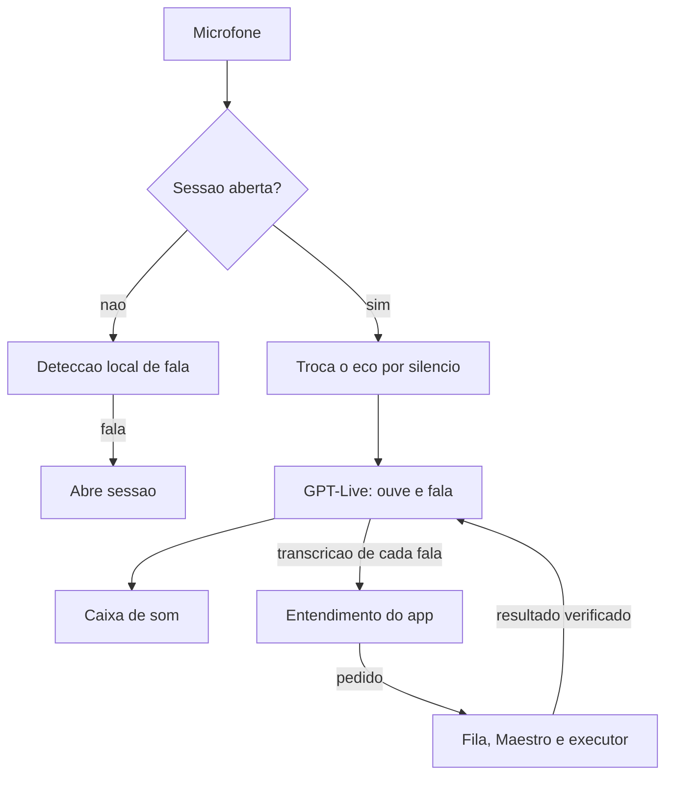
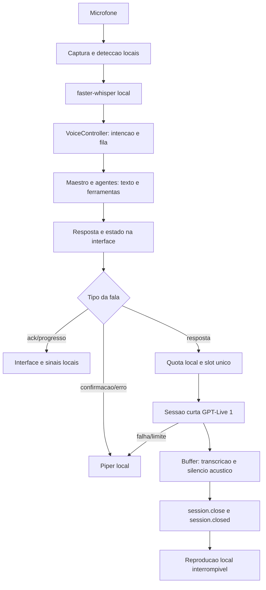

# GPT-Live 1: conversa em tempo real e narração

Decisão de 2026-11-03: manter `gpt-live-1`, conforme escolhido pelo proprietário, aceitando
cobrança pelo tempo completo de cada sessão e reduzindo sua duração. Não substituir o modelo
silenciosamente nem tratar o GPT-Live como um endpoint de TTS convencional.

Decisão posterior do proprietário, no mesmo dia: o modo Conversa usa conversa real com delegação,
**com o áudio do microfone indo para a OpenAI** durante a conversa. Fora dele continua valendo a
narração sob demanda descrita a partir de "Contrato de custo", com microfone e transcrição locais.

## Modo Conversa



| Componente | Responsabilidade |
| --- | --- |
| `core/voice/live_session.py` | Sessão, microfone, reprodução, eco, abertura e fechamento, reservas |
| `desktop/voice.py` (`_conv_*`) | Decide o que vira tarefa, liga resultados à delegação, volta ao modo local em falha |

**Quem decide o que é tarefa é o app.** O modelo às vezes diz que vai agir sem delegar, então o
evento `session.delegation.created` é só um sinal extra. Um pedido entendido roda mesmo sem
delegação; uma delegação sem pedido entendido não roda nada, e o modelo é avisado disso. O modelo
não tem ferramentas, e as regras de permissão continuam no Maestro e no executor.

**Custo.** Sem fala por `conversation_idle_s` (60 s) a sessão fecha; reabre quando a detecção local
percebe fala ou quando há resultado para contar. Se reabriu por ruído e ninguém falou, fecha em
`wake_grace_s` (12 s). A reserva cresce em fatias de 60 s e `daily_max_s` encerra a conversa.

**Falha.** Sessão recusada, sem quota, sem microfone ou com duas quedas seguidas devolve a conversa
à transcrição e à voz locais, sem nova tentativa por 5 minutos. A chave de Configurações desliga o modo.

**Medido em 2026-11-03, com áudio sintético e sem caixa de som:** sessão iniciada em cerca de 0,8 s;
transcrição de "Abre a calculadora" entregue 1,8 s após o fim da fala (incluindo 0,9 s de espera de
pausa); delegação em cerca de 1,5 s; confirmação falada pelo modelo.

**Ainda não validado:** voz humana, eco real de caixa de som, interrupção real, e o resultado de uma
tarefa sendo falado com `delegation_id` na API (a fala de `commentary` foi confirmada só com `null`).

A fala do modelo é livre: ele pode parafrasear um resultado. Na conversa, o texto exato continua na tela.

### Áudio sem cortes

- **Reprodução contínua com folga.** A saída de som roda o tempo todo, com silêncio quando não há fala, porque
  fone Bluetooth adormece e engole o início da fala seguinte. `PlaybackBuffer` guarda 200 ms antes de tocar e
  preserva o trecho baixo que antecede a voz.
- **Fone não é filtrado.** Nos primeiros ~600 ms de fala do agente, o app mede se o microfone o ouve. Se não
  ouve (fone), o áudio segue direto o tempo todo: silenciar só engolia o começo do que a pessoa dizia.
- **Caixa de som: interrupção em dois passos.** A voz da pessoa é comparada com o eco esperado para o volume tocado
  naquele momento. Primeiro ela chega ao modelo, que para por conta própria; só insistindo por ~720 ms o áudio local é
  descartado. Não há cancelamento de eco de verdade: em caixa de som, falar por cima é menos sensível que no fone.
- **Fim da fala.** Silêncio na transcrição não basta: ela chega em rajadas. O turno espera a voz local parar por
  0,45 s e a transcrição por 0,6 s (0,25 s se o modelo já delegou), e aguarda mais quando a frase termina em palavra
  aberta ("com o mouse em").
- **Toda fala tem resposta.** Sem fala do modelo em 2,5 s, o app responde com o que entendeu. Ruído não é respondido.
- `memory/voice_conversation.jsonl` guarda só contagens por sessão (interrupções, falta de áudio, quedas),
  nunca fala nem transcrição, para investigar cortes com evidência.

### Onde vai o tempo

`python scripts/latency_report.py --voice` mostra a mediana e o P90 de cada etapa, a partir do fim da fala:
transcrição, início da fala do agente, fim do turno, entendimento, envio, início e fim da tarefa. Os dados ficam em
`memory/voice_latency.jsonl`, só com tempos. Medidas isoladas de 2026-11-03/04: transcrição em cerca de 0,9 s,
entendimento por modelo em 1,2 s e cada ação do piloto em cerca de 1,7 s de modelo.

### O que a fala pode disparar

Regras fixas em `core/voice/understand.py` e `core/obsidian_vaults.py`, que não dependem de modelo. Palpite com
delegação do modelo roda sem nova pergunta, porque dois sinais independentes concordam; a guarda das Configurações
não deixa palpite, então essa combinação não as abre.


- Configurações do Windows só rodam se a própria pessoa disser "configurações".
- Apontar sem nomear ("esse aí", "com o mouse em cima") vira pergunta: o agente não vê o ponteiro.
- Um palpite só roda com um "sim" curto, e só se o modelo tiver mesmo dito aquele palpite em voz alta.
- Pedido de baixa confiança pergunta antes de agir, no modo Conversa.
- Cofre do Obsidian abre por `obsidian://open?vault=NOME`, só para cofres registrados, e a janela é conferida.
  Nome duvidoso vira pergunta.
- Promessa do modelo sem tarefa ("vou clicar") é corrigida em voz alta e não entra no contexto.

## Contrato de custo

O GPT-Live custa US$ 0,05/minuto de sessão, contabilizado por segundo, sem arredondar para um
minuto inteiro. Backend e ferramentas são cobrados separadamente.
[Modelo e cobrança oficiais](https://developers.openai.com/api/docs/models/gpt-live-1).

O aplicativo consegue fechar conexões durante trabalho/espera; não consegue alterar o que o
provedor cobra enquanto uma sessão está aberta. Não promete cobrança somente durante som audível.
Por exemplo, `usage.seconds=24` corresponde a aproximadamente US$ 0,02 de voz nessa tarifa,
além do backend. Isso é cálculo ilustrativo, não benchmark ou limite de fatura.

## Fluxo e responsabilidades



| Componente | Responsabilidade |
| --- | --- |
| `core/voice/recorder.py`, `stt.py` | Captura e transcrição no computador; não dependem de uma sessão OpenAI |
| `desktop/voice.py` | Intenção, fila de tarefas, classificação da fala e eventos; tarefas continuam independentes da voz |
| `core/voice/tts.py:create_speaker` | Seleção local/Live por configuração e presença de chave, sem sondar a API |
| `core/voice/demand.py` | Uma geração ativa e um slot pendente; último pedido vence; parada e fallback local |
| `core/voice/live.py` | Protocolo Live, limites, áudio, transcrição, encerramento e contabilização |
| `memory/voice_usage.json` | Contador local de segundos; sem texto, áudio, chave ou histórico de conversa |

A interpretação de voz e o backend existentes ainda podem chamar Anthropic e gerar custo por
tokens. “Microfone local” não significa raciocínio gratuito. A chave OpenAI não substitui a Anthropic.

## Ciclo de uma resposta

1. O controller termina de preparar uma resposta curta. A tarefa não mantém uma conexão Live
   enquanto trabalha ou espera; uma nova resposta de conversa pode abrir sua própria sessão curta.
2. A fila elimina pedidos substituídos/duplicados em andamento e verifica cancelamento.
3. O contador reserva uma margem conservadora antes de qualquer conexão.
4. Abre WebSocket no endpoint oficial fixo, autentica em Python e envia `session.start` com
   `model=gpt-live-1`, `store=false`, PCM16 mono 24 kHz e `delegation: {"type": "client"}`.
   A API recusa `delegation: null` com `invalid_type` e fecha a conexão, apesar de a referência
   descrever `null` como válido.
5. Após `session.started`, fornece o texto para narrar e envia silêncio sintético no ritmo de
   amostragem. **Nunca envia gravação do microfone, capturas ou o vault ao GPT-Live.**
6. Acumula áudio e transcrição. O modelo não recebe ferramentas ou backend Responses; eventos de
   delegação são ignorados e erros encerram a tentativa, sem executar ações ou abrir outra geração paga.
7. Exige fala fiel ao texto (ao menos 75% de semelhança e os mesmos números) e ao menos 0,8 s de
   silêncio nos samples PCM. Números verbalizados de forma diferente podem causar fallback.
8. Solicita fechamento e aguarda `session.closed`. O áudio só segue para reprodução após
   confirmação de fechamento/uso e validação do clip; caso contrário, resposta local.
9. Remove silêncio inicial de preparação, preservando uma margem curta, e reproduz o buffer
   localmente. Interrupção descarta pendências e interrompe o stream sem
   abrir outra sessão. Novos pedidos preservam a exclusividade de geração.

O [protocolo oficial](https://developers.openai.com/api/docs/guides/voice-websockets?api=live)
não tem evento de áudio concluído. A heurística usa o áudio efetivo e a transcrição, não um
intervalo sem pacotes ou uma pausa de legendas. É uma estratégia conservadora a validar com
áudio real; correspondência de transcrição não certifica fidelidade acústica.

O GPT-Live pode parafrasear ou permanecer em silêncio mesmo após aceitar uma instrução de fala.
Por isso, aceitação de comando não vale como entrega. Ver
[gerenciamento e limites de fala](https://developers.openai.com/api/docs/guides/live-conversations).

## Limites implementados

```yaml
voice:
  tts: auto
  live:
    voice: marin
    session_max_s: 25
    startup_timeout_s: 10
    close_timeout_s: 3
    conversation_idle_s: 45
    wake_grace_s: 12
    daily_max_s: 1800
```

- Nenhuma chamada paga em construtor, pré-carga, idle, ACK ou aviso de progresso.
- Uma sessão por resposta; zero retries/reconexões automáticas.
- Texto curto, limpo pelo pipeline existente (até 240 caracteres), sem URLs/caminhos na narração.
- Timeout de geração contado desde o início da tentativa; fechamento com prazo próprio.
- Payload, áudio e transcrição têm limites de tamanho.
- Sem gravação em disco do conteúdo durante uso normal; buffer em memória descartado após a fala.
- Contabilidade diária em UTC, com reserva persistida antes da conexão; só o uso final confirmado
  substitui a reserva. Atualizações cumulativas não devem ser somadas como novos gastos.
- Ausência de confirmação final mantém a reserva como gasta, inclusive após reiniciar, sem bloquear
  a próxima sessão; a quota diária continua limitando o total. Não se presume custo zero quando a
  rede cai. Bloquear aqui deixava toda resposta seguinte falhar com `ValueError`.
- Duas falhas seguidas de narração: voz local por 5 minutos, sem abrir sessão paga a cada resposta.

A quota é proteção operacional do aplicativo, não trava de faturamento da conta. Outras aplicações,
instâncias simultâneas, falha de rede/finalização e o provedor podem divergir do contador local.
A redução de gasto ainda precisa ser medida em uso real, incluindo latência de criação de sessão.

## Ativação

Preparar/atualizar o ambiente uma vez com `scripts/setup.ps1`, que instala o lock incluindo
`websocket-client==1.9.2`. No `.env` local da raiz, manter a chave Anthropic e acrescentar:

```dotenv
OPENAI_API_KEY=COLE_SUA_CHAVE_REAL
```

Reiniciar o aplicativo. Com `voice.tts: auto`, uma chave preenchida seleciona GPT-Live 1;
sem chave, mantém Piper. O exemplo acima é placeholder e não ativa uma chamada válida.
Não inserir chaves na interface/QML, notas, código ou no Git.

Para desativar a nuvem, retirar a chave e reiniciar ou selecionar `voice.tts: piper`/`sapi`.
O projeto/conta OpenAI precisa ter acesso ao modelo. Presença de chave não comprova acesso.
Nesta cópia do projeto, o ambiente `.venv` Python 3.11 já foi preparado com o lock e conferido.

## Falha e recuperação

Fallback usa Piper local, sem segunda tentativa paga. Uma falha de voz não reinicia a tarefa
nem altera autorização do executor. Os diagnósticos mostram o código de erro do provedor, sem
corpo da resposta, credenciais ou texto privado.

Reservas sem uso final ficam registradas em `unconfirmed_sessions` em `memory/voice_usage.json`
e contam como gastas até a virada do dia UTC; não é preciso editar o arquivo.
Uma recusa antes de a sessão iniciar (handshake ou `session.start`) libera a reserva com uso zero.
Isso não se aplica a uma conexão perdida após iniciar sessão.

## Verificação

Testes offline usam socket, relógio e reprodução simulados para observar: zero conexões em idle,
chave/quota antes da conexão, modelo exato, ausência de microfone/backend, uso final, cancelamento,
fechamento incompleto, erro, paráfrase, fila limitada, fallback e proteção de diagnóstico.

Depois de adicionar a chave, teste opcional **pago**, com frase sintética, sem microfone e sem
reprodução automática:

```powershell
.\.venv\Scripts\python.exe ai-farm-agent/scripts/smoke_live_voice.py --allow-live
```

Salva `voice.wav` e `result.json` em `ai-farm-agent/memory/live-voice-smoke/` (ignorado).
Ouvir o WAV é necessário para validar qualidade/pronúncia. O teste não roda na CI nem no gate padrão.

**Limites da narração:** pronúncia e naturalidade não foram avaliadas por uma pessoa. Bufferização
mais reconexões aumentam o tempo até ouvir uma resposta; por isso o modo Conversa não a usa.
Os bloqueios de produção gerais do projeto continuam no relatório de readiness.

Os testes de `tests/test_live_voice.py` e `tests/test_live_conversation.py` usam transporte,
microfone e reprodução simulados. A validação automática não abre o microfone nem usa a API.
